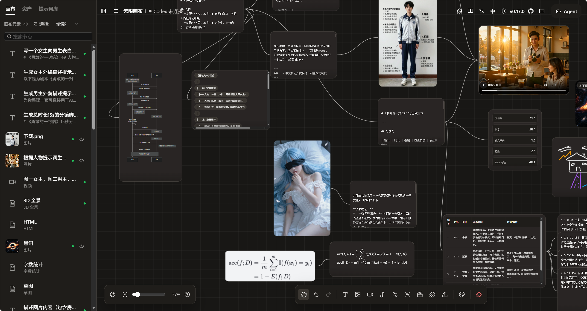
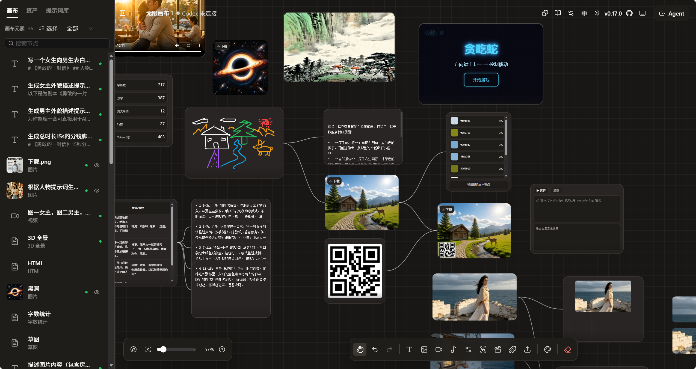
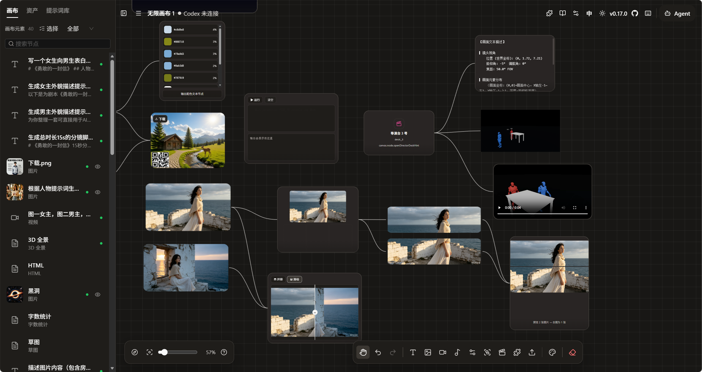
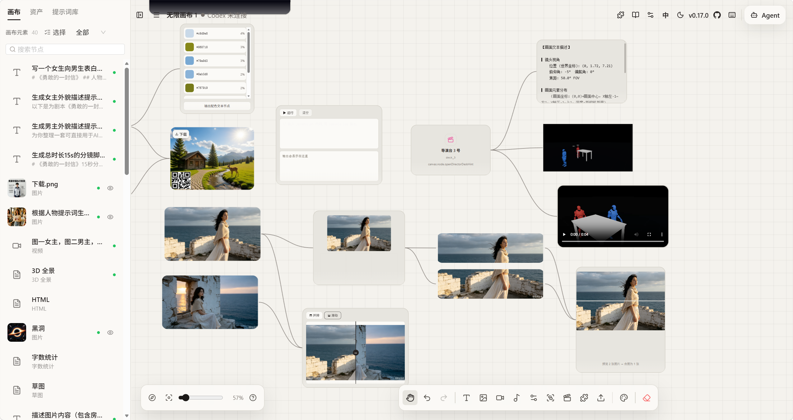
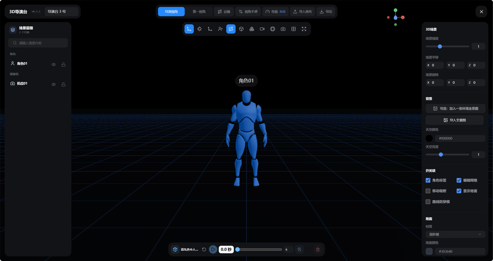
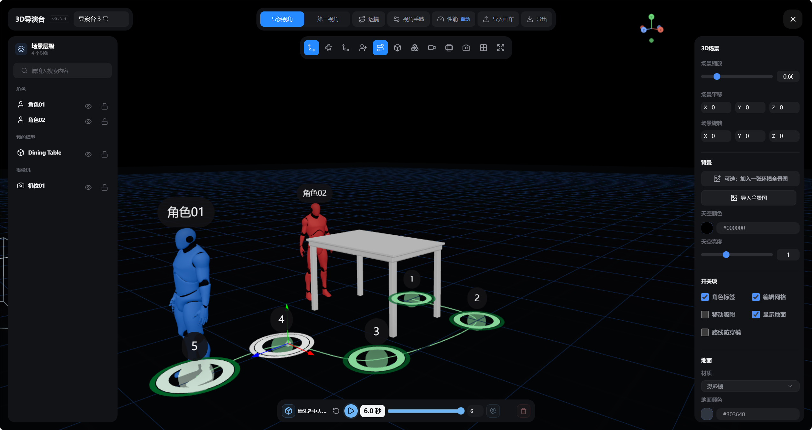
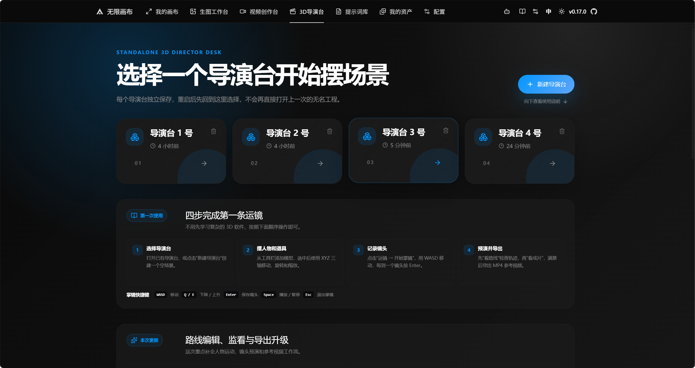
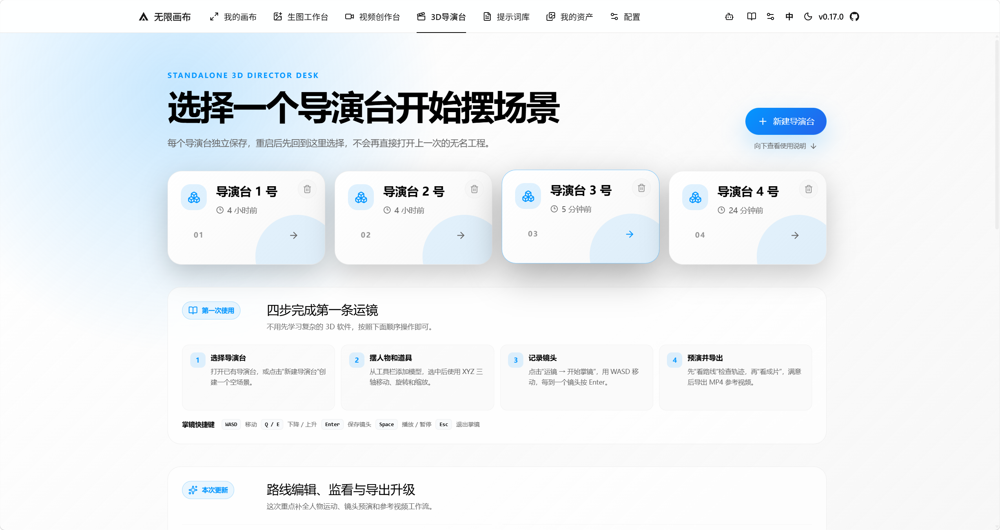

# Canvas Director


Canvas Director 把两件原本分开的事放进同一个浏览器页面：在无限画布上编排创作，在 3D 导演台中预演镜头。剧本、提示词、角色设定在画布上以节点形式生长；分镜摆位、机位运动、角色动作在导演台里用双时间轴精确打磨；预演结果直接回流画布，交给 AI 完成最终生图与生视频。

## 设计立场

Canvas Director 选择一条更接近真实制作流程的路径：

| 环节 | 谁来做 | 在哪里做 |
| --- | --- | --- |
| 剧本拆解、角色设定、提示词迭代 | 你 + LLM | 无限画布节点 |
| 分镜摆位、机位运动、角色动作 | 你 + 3D 导演台 | 嵌入画布的 3D 场景 |
| 预演参考生成 | 浏览器实时渲染 | 导演台导出帧 / MP4 |
| 最终画面与视频 | AI 模型 | 画布生成节点，以预演为参考 |
| 批量编排与画布操作 | Canvas Agent（本机 / 浏览器内置） | 画布与导演台共用的 Agent 面板 |

画布是创作状态，导演台是空间校验，AI 是最终执行。三者通过节点和 postMessage 串成闭环，而不是三个互不相干的标签页。

## 核心能力

### 无限画布：创作的主线

画布是整个项目的起点和归宿。节点承载剧本段落、提示词草稿、角色卡、参考图、生成结果和导演台预演素材。

- **视口与导航**：拖拽平移、滚轮缩放、小地图、缩放滑杆、视角回退；点阵 / 网格背景与浅色 / 深色主题。
- **节点编排**：拖拽移动、四角缩放、连线关联；框选、多选、打组 / 解散；复制粘贴、批量导出；双击空白快速建节点。
- **完整撤销重做**：节点、连线、视口、背景、助手会话均纳入历史栈。
- **文件拖入即节点**：本地图片、视频、音频拖入画布自动生成对应资源节点。
- **元素列表与居中聚焦**：列表 / 缩略图视图，一键定位到画布节点；可开启「选中自动居中」。
- **紧凑侧栏**：元素与资产共用同一自适应列宽规则，面板越宽列数越多。
- **镜头节点**：记录镜头序列、关联导演台机位、标记 QC 状态与时长，作为视频编排的基本单位；镜头只能按叙事顺序相连。
- **导出画布**：整个画布或选中元素连同引用资源打包为压缩包。

画布的上游 infinite-canvas 本身已经是一个成熟的 AI 视觉创作工作台，Canvas Director 在此基础上保留了它的画布交互与节点体系，并将 3D 导演台作为一等节点嵌入。

### 3D 导演台：在生成之前把镜头想清楚

导演台不是画布里的一个“预览小窗”，而是一个与画布共享时间轴、共享机位、共享全景背景的独立 3D 场景。它的上游 3d-director-desk 已经验证了浏览器端运镜预演的可行性，Canvas Director 把它从独立页面变成画布工作流中的一环。

- **场景摆位**：内置人物与道具库（GUO / Mixamo 兼容资源），快速搭建初始站位。
- **外部模型导入**：FBX / GLB 角色导入，骨骼识别与 15 个语义区域自动映射；导入后自动直立、缩放、吸附地面。
- **全景背景**：JPG / PNG / WEBP 全景导入，本地 IndexedDB 存储；支持替换、删除、旋转、亮度调节，多视图共享同一资源。
- **地面材质**：工作室、水泥、沥青、木地板、草地；网格对齐与移动吸附。
- **双时间轴**：摄影机轨迹与角色动作分轨展示，关键帧精确定位；支持播放、暂停、拖动检查。
- **运镜轨迹**：平滑 / 直线路径，各段独立缓动（匀速、缓入、缓出、柔缓）；轨迹点可“穿过”或“停留”，停留可指定时长与动作。
- **身体部位追踪**：每个机位点可独立选择追踪目标与身体部位（全身、头部、胸部、腰部、四肢，共 16 个语义区域），支持即时跟随与柔和跟随。
- **多视图同步**：主视图、监视器窗口、第一人称视角共享同一时间轴，姿态、机位、全景完全一致。
- **社区运镜预设**：dolly in/out、pan、tilt、轨道、摇臂弧线、手持抖动、平行跟拍等。
- **性能档位**：自动 / 流畅 / 画质三档，统一控制 DPR、抗锯齿与播放刷新率；导出分辨率不受预览设置影响。
- **导出与回传**：干净参考截图（PNG）与 H.264 MP4，通过 postMessage 回传画布节点。
- **改名同步**：顶栏双击修改导演台名称，来源画布上绑定的导演台节点标题同步更新。
- **Agent 可驱动**：导演台的全部摆位、运镜、导出能力都以工具形式暴露给 Canvas Agent，可在后台静默执行。

### AI 生成：以预演为参考，而不是从零“文生图”

Canvas Director 接入任意 OpenAI 兼容渠道，覆盖图像、视频、音频与 LLM 对话。与单纯“输入提示词出图”不同，这里的生成节点可以引用画布上导演台导出的预演帧作为空间参考，让模型在构图、机位和角色站位上有一个可见的锚点。

- **图像**：文生图、图生图 / 参考图编辑、遮罩局部重绘；保留原图比例，支持透明背景。
- **视频**：文生视频、图生视频、关键帧动画；首尾帧与全能参考模式；时长 4–30 秒，480p / 720p / 1080p。
- **默认比例**：设置中可指定默认画面比例与视频比例，新建节点与重新生成自动沿用，单节点仍可覆盖。
- **重新生成策略**：已有内容的节点再次生成时，可原地覆盖或新建节点保留原图。
- **音频**：文本驱动音频生成，可作为独立节点插入画布。
- **LLM 对话**：多模型切换与推理强度设置，可接收画布参考图，具备图片理解能力。
- **@ 引用**：输入框内 @ 引用已连接的图片 / 视频节点，图片显示真实缩略图；多参考图按规范提交。
- **批量与重试**：多图叠卡预览与备选结果；失败项单独重试或删除，成功项下载或设为主图。
- **断点续传**：视频任务保存远端任务 ID，刷新后自动继续轮询，也可手动查询。
- **自定义调用脚本**：通过 JavaScript 脚本对接中转站与自建服务，支持图片质量、背景、参考素材、分辨率与比例等参数；脚本按需手动绑定，不按模型名自动套用。

### Canvas Agent：让画布和镜头都可以被“操作”

画布页与导演台共用同一套浮动 Agent 面板，可在「本机 Agent」与「浏览器内置」两种引擎间切换。

- **本机 Agent**：本地 Codex / ZCode CLI 通过 MCP 接入，Agent 运行在你自己的机器上，浏览器状态不暴露给外部服务器。
- **浏览器内置 Agent**：直接使用模型配置中的 text 渠道做 function calling，无需安装任何本地程序；对话按页面上下文保存在本地，刷新后自动恢复。
- **画布感知**：读取当前画布状态、选中节点、连线关系、生成进度，执行结构化编辑。
- **导演台工具链**：可创建镜头、在后台静默打开导演台、清场摆位、设置姿势与运镜预设、精修关键帧、导出参考帧与预演视频并自动写回画布。
- **流式对话**：Markdown 渲染、代码块、外链确认；`@` 引用画布资产、`/` 引用 Skill。
- **三档权限**：执行敏感操作前需用户确认；`--debug` 日志按日期保存。
- **生成前确认**：任何图片或视频生成任务执行前，Agent 都必须先列出参数并征得当次确认。
- **Skill 管理**：查看、创建、编辑、删除、启停和显式调用本地 Skill；可从对话或画布生成 Skill 草稿。
- **会话隔离**：多标签页活跃画布与 turn 相互独立；刷新后保留附件、Skill 引用与本地缩略图。
- **凭据安全**：连接 Token 经 URL fragment 传递并在读取后立即清除；敏感信息不写入服务器日志和浏览器历史。
- **面板外观**：可拖拽、贴近屏幕边缘自动停靠，支持毛玻璃透明度调节。

### 插件系统：节点类型不写死

画布节点通过插件机制扩展，支持通过 URL 动态安装与更新，并提供 TypeScript SDK。

- **内置 18+ 插件**：Markdown、SVG、HTML、360° 全景、便利贴、Mermaid、LaTeX、代码运行、JSON 表格、思维导图、二维码、取色板、草图、切图 / 合图 / 图片对比、字数统计、音频波形裁剪等。
- **AI 写回节点**：Mermaid、LaTeX、JSON 表格、思维导图支持 AI 文本生成，结果流式写回节点并自动剥离代码围栏。
- **远程插件**：URL 安装、更新、卸载；官方注册表一键安装。
- **开发 SDK**：自定义节点类型、渲染逻辑、检查面板、序列化与迁移；生成面板支持 text 模式写回自身。

### 提示词与素材库

- **提示词来源**：七种来源（含 ImagePrompts、BananaPromptQuicker、Freestylefly 等），独立启用、手动刷新与定时刷新；支持自定义标准 JSON 来源；刷新失败保留上次成功缓存。
- **提示词中心**：跨来源全局搜索、标签筛选、详情查看、一键复制并插入画布。
- **素材资产**：常用图片、视频、音频、提示词保存为可复用资产；上传添加、卡片移除、批量导出。

### 配置与同步

- **渠道配置**：多模型渠道管理，分别设置默认文本 / 图片 / 视频模型；OpenAI / Gemini 格式协议适配。
- **导入导出**：渠道、模型、生成参数、提示词源、WebDAV 配置以 JSON 备份与迁移。
- **WebDAV 同步（可选）**：跨设备画布项目与素材同步；测试连接、手动同步、冲突处理。
- **本地代理（可选）**：模型列表、生图、生视频、文本、音频请求统一经本机代理转发，规避 CORS。

## 工作流：从画布到镜头，再回到画布

```text
┌─────────────────────────────────────────────────────────────┐
│  无限画布                                                    │
│  ├─ 剧本节点 / 提示词节点 / 角色设定节点                     │
│  ├─ 镜头节点 ──→ 按叙事顺序串联                               │
│  ├─ 3D 导演台节点 ──→ 摆位 / 运镜 / 动作 / 导出预演帧 & MP4  │
│  ├─ 生成节点（@ 引用导演台预演素材作为参考）                 │
│  └─ 结果节点 ──→ 继续迭代 / 打组 / 进入下一镜头              │
└─────────────────────────────────────────────────────────────┘
          │                              ▲
          │ 画布状态 / 节点操作 / 导演台工具 │ 写回产物 + 改名同步
          ▼                              │
┌─────────────────────────────────────────────────────────────┐
│  Canvas Agent（本机 Codex CLI + MCP / 浏览器内置引擎）        │
│  读取画布 → 建镜头 → 摆场景运镜 → 导出写回 → 审批敏感操作    │
└─────────────────────────────────────────────────────────────┘
```

1. 在画布节点中编写剧本、提示词与角色设定，按剧情排列，用镜头节点串联。
2. 打开 3D 导演台，摆放人物、道具、全景背景与地面材质。
3. 配置摄影机运镜轨迹，录制镜头运动，导出干净参考截图与 H.264 视频。
4. 预演素材通过 postMessage 回到画布对应节点。
5. 将预演帧链接到生成节点，交给 AI 完成最终生图 / 生视频。
6. 结果回到画布，继续迭代、分组、整理，进入下一镜头。

以上第 1–6 步也可以整体交给 Agent：一条对话指令即可完成「建镜头 → 开导演台 → 摆场景 → 运镜 → 导出写回 → 生成参考图」。

## 项目截图

### 无限画布

<p>
  
  
</p>
<p>
  
  
</p>

### 3D 导演台

<p>
  
  
</p>
<p>
  
  
</p>

## 快速开始

### 在线部署

项目自带 `vercel.json` / `render.yaml`，可一键部署到 [Vercel](https://vercel.com) 或 [Render](https://render.com)。纯前端，无后端服务。

GitHub Pages 静态文档站点：[点击查看在线文档](https://haitang-hub.github.io/Canvas-Director)。

### 本地开发

```bash
git clone https://github.com/Haitang-Hub/Canvas-Director.git
cd Canvas-Director

# 前端 → http://localhost:5070
cd web && npm install && npm run dev

# 文档站点（可选）→ http://localhost:3000
cd ../docs && npm install && npm run dev
```

Windows 下也可直接双击根目录 `start.bat`：自动写入代理配置、启动本地 canvas-proxy 与前端开发服务器。

### 启动本地 Canvas Agent（可选）

```bash
npx -y @basketikun/canvas-agent@latest
# http://localhost:17371
```

### 启动本地代理（可选，解决 CORS）

```bash
npx @basketikun/canvas-proxy@latest --port 23210
# http://localhost:23210
```

### Docker 部署（可选）

```bash
docker-compose up -d
```

Docker 静态资源路径为待验证项，生产环境完整部署建议自行测试。

## 技术栈

- **前端框架**：React 19 + TypeScript 5
- **构建工具**：Vite 7
- **UI 组件**：Ant Design 6 + Tailwind CSS v4
- **状态管理**：Zustand 5（localforage 持久化）
- **3D 渲染**：Three.js 0.184 + React Three Fiber 9
- **Agent 运行时**：Node.js ≥ 18 + @openai/codex
- **本地代理**：纯 Node.js（CORS 转发）
- **插件协议**：MCP（Model Context Protocol）

## 文档

完整索引见 [docs/index.md](docs/index.md)。

- [快速开始](docs/content/docs/overview/quick-start.zh-CN.mdx)：安装配置与上手指南
- [功能介绍](docs/content/docs/overview/features.zh-CN.mdx)：全部功能详细说明
- [画布节点指南](docs/content/docs/canvas/canvas-node-manual.zh-CN.mdx)：各节点类型用法参考
- [画布快捷键](docs/content/docs/canvas/canvas-shortcuts.zh-CN.mdx)：快捷键一览
- [本地开发](docs/content/docs/development/local-development.zh-CN.mdx)：本地调试与构建
- [Docker 部署](docs/content/docs/overview/docker.zh-CN.mdx)：容器化部署方案
- [Agent 连接说明](docs/content/docs/development/local-codex-canvas.zh-CN.mdx)：Codex Agent 集成方式
- [安全说明](docs/content/docs/support/security.zh-CN.mdx)：安全模型与漏洞反馈

## 数据与安全

- **本地优先**：画布项目与「我的素材」主要保存在浏览器本地（IndexedDB via localforage），项目本身不提供云账户或云存储；可自行配置 WebDAV 跨设备同步。
- **API 密钥**：AI API Key 保存在浏览器本地，由前端直接请求你配置的 OpenAI 兼容接口。请使用可信渠道的密钥，不建议填入来源不明的中转站。
- **本地代理**：开启后所有模型请求经本机转发，代理本身不记录敏感内容。
- **Agent 安全**：本机 Agent 运行在你自己机器上，连接 Token 经 URL fragment 传递并在读取后立即清除；MCP 初始化期间禁用按钮防止提前发送；调试日志中的常见凭据自动脱敏。浏览器内置 Agent 的对话记录保存在本地浏览器，同样不会上传。
- **生产部署**：Docker 静态资源路径为待验证项，完整部署验证建议自行测试。

## 致谢

Canvas Director 构建于两项开源项目的成果之上：

- [Infinite Canvas](https://github.com/basketikun/infinite-canvas)，作为无限画布、AI 生成节点、智能代理（Agent）体系与插件机制的底层基座；
- [3D Director Desk](https://github.com/xiaozangao/3d-director-desk)，用于验证浏览器端三维运镜、双时间轴、骨骼追踪与 postMessage 跨框架嵌入协议。

## 许可证

[MIT](LICENSE)
